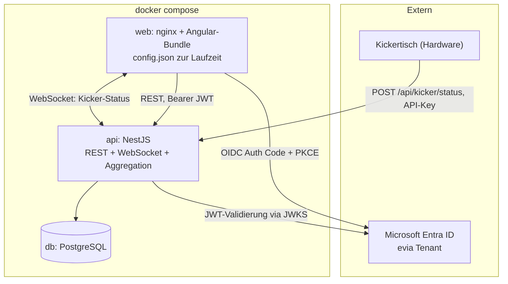

# Kicker-Portal: Ablösung von Firebase, Containerisierung, Angular-Modernisierung

## Status (Stand: siehe Git-Historie)

| Phase                      | Status                                                                                                                                                                                                     | Branch                              |
| -------------------------- | ---------------------------------------------------------------------------------------------------------------------------------------------------------------------------------------------------------- | ----------------------------------- |
| 0 Aufräumen und Sichern    | Teilweise. Lokale Bereinigung (Protractor/Codelyzer) fertig. Rules-Export und Firestore/Auth-Export noch offen — mit dem inzwischen eingerichteten Service-Account-Zugriff (siehe unten) jetzt nachholbar. | `migration/phase-0-cleanup`         |
| 1 Angular 16 auf 20        | Fertig, 10 Commits                                                                                                                                                                                         | `migration/phase-1-angular-upgrade` |
| 2 Laufzeit-Konfiguration   | Fertig                                                                                                                                                                                                     | `migration/phase-2-runtime-config`  |
| 3 Backend und Datenbank    | Fertig                                                                                                                                                                                                     | `migration/phase-3-nestjs-backend`  |
| 4 Datenmigration           | Fertig, gegen echte `T-`-Testdaten in `evia-desk` verifiziert                                                                                                                                              | `migration/phase-4-data-migration`  |
| 5 Frontend umschalten      | Fertig. Direkt gegen die neue API umgestellt (kein Feature-Flag-Rollback auf Firestore, siehe Abweichung unten)                                                                                            | `migration/phase-4-data-migration`  |
| 6 Auth auf Entra ID        | Code fertig, direkter Cutover (kein Dual-Issuer-Zwischenschritt, siehe unten). App-Registrierung, `entra_oid`-Backfill für Bestandsnutzer und `is_admin`-Seeding stehen noch aus                           | `migration/phase-4-data-migration`  |
| 7 Angular 21 und 22        | Fertig, in zwei Commits (20→21, 21→22)                                                                                                                                                                     | `migration/phase-4-data-migration`  |
| 8 Containerisierung und CI | Fertig                                                                                                                                                                                                     | `migration/phase-4-data-migration`  |

**Abweichungen von Phase 5/6 gegenüber diesem Plan:** Phase 5 hat Firestore
direkt vollständig durch die REST-API ersetzt statt hinter einem
Feature-Flag mit Rollback-Option zu isolieren. Phase 6 validiert deshalb
ausschließlich Entra-ID-Tokens (kein Dual-Issuer-Zwischenschritt mit
Firebase) - beide Entscheidungen wurden bewusst getroffen, da die im Plan
vorgesehene Rollback-Option ohnehin entfallen war.

**Unerwarteter Fund in Phase 7:** TypeScript 6.0 (von `@angular/compiler-cli@22`
verlangt) ändert den Default von `strict` auf `true`. Dieses Projekt lief nie
unter Strict Mode, daher jetzt explizit `"strict": false` in `tsconfig.json`
gesetzt, um das bisherige Verhalten zu erhalten - eine echte Strict-Mode-
Einführung wäre ein eigenes, deutlich größeres Vorhaben.

**Unerwarteter Fund in Phase 8:** `api/package.json`s `start:prod`-Skript
zeigte auf `node dist/main` statt des tatsächlichen `nest build`-Outputs
`dist/src/main` (bedingt durch `sourceRoot: "src"` in `nest-cli.json`) - ein
vorbestehender Bug, der nie auffiel, weil lokal immer `start:dev` lief. Erst
beim Bauen des Produktions-Docker-Images sichtbar geworden und korrigiert.

**Zugriff auf `evia-desk` eingerichtet:** Ein Firebase-Service-Account-Schlüssel liegt lokal
unter `~/secrets/evia-desk-adminsdk.json` (nicht im Repo, gitignored referenziert über
`api/.env`). Ermöglicht ab sofort echte Firestore-Lese-Zugriffe für Migrationsskripte und
Backend-Auth-Tests, die vorher nur gegen synthetische Fixtures liefen.

**Zwei während der Umsetzung gefundene echte Bugs** (zusätzlich zu den unten beschriebenen,
vorab bekannten):

- Alle 17 Matches in `T-Matches` haben kein `date`-Feld, obwohl `IMatch` es als Pflichtfeld
  deklariert. Migrationsskript behandelt das jetzt robust (Postgres-Default, Warnung pro
  Dokument, kein Abbruch).
- `@angular/fire` gibt es entgegen der ursprünglichen Annahme nicht nur bis 20.0.1, sondern
  auch als Release Candidate für 21 (`21.0.0-rc.0`) — ändert nichts an der Phasenreihenfolge
  (für 22 existiert weiterhin nichts), bestätigt sie aber nur knapper als gedacht.

---

## Context

Das Kicker-Portal läuft heute vollständig auf Firebase: Hosting, Auth (Microsoft OAuth),
Firestore, Realtime Database und Cloud Functions. Das Projekt soll stattdessen als
selbst gehosteter Stack per `docker compose up` lauffähig sein und gleichzeitig auf einen
aktuellen, wartbaren Technologiestand kommen.

Der Ist-Zustand war Angular 16.2.12 (Stable ist 22.1.0, geprüft per `npm view`), TypeScript 4.9,
NgModule-Architektur, Karma und Protractor. Firebase steckte nicht nur in der Infrastruktur,
sondern im Datenmodell: `DocumentReference` und `Timestamp` waren in den Interfaces verdrahtet,
die komplette Statistik-Aggregation lebte in Cloud-Functions-Triggern, der Auth-Guard kam aus
`@angular/fire/auth-guard`, und die Test/Prod-Trennung lief über ein clientseitiges
Collection-Präfix `T-`.

Ziel ist eine schrittweise Migration, bei der das Projekt nach jeder Phase baubar und startbar
bleibt. Kein Big-Bang-Rewrite.

### Drei Befunde aus der Analyse, die den Plan prägen

1. **`@angular/fire` existiert nur bis 20.0.1 stabil** (Peer: `@angular/core@^20`; ein Release
   Candidate für 21 existiert, für 22 nichts). Angular 22 ist mit `@angular/fire` nicht
   erreichbar. Das Angular-Upgrade musste daher bei 20 pausieren und läuft erst nach dem
   Firebase-Ausbau weiter. Angular 22 verlangt zusätzlich TypeScript `>=6.0 <6.1`.
2. **`firestore.rules`, `firestore.indexes.json` und `database.rules.json` fehlen im Repo**,
   obwohl `firebase.json` sie referenziert. Der produktive Autorisierungsstand ist unbekannt
   und muss vor der Migration aus dem Firebase-Projekt exportiert werden.
3. **Zwei Datenfehler, die in die Migration hineinspielen:**
   - [matches.service.ts](src/app/shared/services/matches.service.ts): Die Team-Referenzen
     werden mit einem Tippfehler gebaut (`` `${environment.prefix}Teams/${team1})}` ``), die
     gespeicherten `teams`-Referenzen in `Matches` haben also kaputte IDs. Unbemerkt geblieben,
     weil die Cloud Function die Team-IDs aus den Schlüsseln von `result` liest. Die
     Migrationsskripte in `api/scripts/` umgehen das bewusst genauso.
   - [update-users-teams.ts](functions/src/update-users-teams.ts): `updateUsersProcedure`
     schreibt ohne `prefix` nach `Users/`. Single-Matches aus der Testumgebung landen damit
     in den Produktivdaten.

### Getroffene Entscheidungen

| Thema          | Entscheidung                                        |
| -------------- | --------------------------------------------------- |
| Angular        | 16 auf 20 vor dem Firebase-Ausbau, 21 und 22 danach |
| Auth           | Direkt gegen Microsoft Entra ID, kein Keycloak      |
| Backend        | NestJS                                              |
| Datenbank      | PostgreSQL                                          |
| Produktivdaten | Vollständig migrieren, Aggregate neu berechnen      |

---

## Zielarchitektur



### Zieldatenmodell

Fünf Firestore-Collections (`Users`, `Teams`, `Matches`, `Single-Matches`, `Playtime`) werden
relational aufgelöst:

- `users` (id uuid, entra_oid unique, legacy_firebase_uid unique nullable, name, is_admin)
- `teams` (id uuid, name) und `team_players` (team_id, user_id), Unique-Constraint über die
  sortierte Spielermenge
- `matches` (id uuid, played_at timestamptz, is_single bool)
- `match_participants` (match_id, side, team_id nullable, user_id nullable, rounds_won)
- `match_rounds` (match_id, round_no, winner_side, domination bool)
- `playtime` (id, start_time timestamptz, end_time timestamptz)

Die heute per `FieldValue.increment` fortgeschriebenen Aggregate (`wins`, `losses`,
`dominations`, `defeats`, `stats['2:1']` sowie die `s_`-Varianten in
[user.interface.ts](src/app/shared/interfaces/user.interface.ts)) werden nicht mehr
gespeichert, sondern live aus `match_rounds` berechnet (`api/src/leaderboard/leaderboard.service.ts`).
Das eliminiert die Drift-Anfälligkeit der heutigen nicht-transaktionalen Trigger.

Die `dominations`- und `defeats`-Arrays sind heute Multisets, in denen dieselbe Referenz
mehrfach vorkommt und die Häufigkeit die Zählung ist. Diese Semantik steckt vollständig in
`match_rounds` und geht nicht verloren.

`legacy_firebase_uid` bleibt dauerhaft erhalten. Es ist der Schlüssel für die Datenmigration
und erlaubt in Phase 5 einen Übergangszustand, in dem das Backend beide Token-Issuer
akzeptiert.

Die heutige `createTeamId`-Logik in [teams.service.ts](src/app/shared/services/teams.service.ts)
(sortierte User-IDs aneinandergehängt) und die davon abhängige
`teamId.startsWith(player.id)`-Auswertung in
[update-users-teams.ts](functions/src/update-users-teams.ts) entfallen. Sie würden mit
Entra-GUIDs statt 28-stelliger Firebase-UIDs ohnehin brechen. Im neuen Schema übernimmt
`MatchesService.findOrCreateTeam` (`api/src/matches/matches.service.ts`) diese Rolle über
eine `array_agg`-Abfrage auf `team_players`.

---

## Phasen

Jede Phase endet in einem baubaren, startbaren Zustand und liegt in einem eigenen Branch.

### Phase 0: Aufräumen und Sichern (0,5 bis 1 PT) — teilweise erledigt

- [x] Protractor, Codelyzer und `firebase-tools` aus den Dependencies in
      [package.json](package.json) entfernen, `e2e/`-Target aus [angular.json](angular.json) lösen
- [ ] Deployte Rules und Indizes exportieren und committen: `firestore.rules`,
      `firestore.indexes.json`, `database.rules.json`
- [ ] Vollständiger Export als Migrationsbasis: `gcloud firestore export`, RTDB-JSON-Export und
      `firebase auth:export users.json`
- [ ] Aus `users.json` die Mapping-Tabelle Firebase-UID zu Entra-`oid` ableiten
      (`providerUserInfo[]` mit `providerId: 'microsoft.com'`, Feld `rawId`), Fallback über `email`

Die drei offenen Punkte sind jetzt technisch machbar (Service-Account-Zugriff steht), aber
noch nicht ausgeführt.

**Fertig heißt:** `npm ci && npm run build` grün, Rules versioniert, Exporte liegen lokal,
Mapping-Tabelle deckt 100 Prozent der aktiven Nutzer ab.

**Abbruchbedingung:** Wenn nicht jede Firebase-UID eindeutig auf einen Entra-Nutzer abbildbar
ist, hier stoppen und die Lücken manuell klären. Ohne vollständiges Mapping ist Phase 5
nicht durchführbar.

### Phase 1: Angular 16 auf 20 (5 bis 8 PT) — erledigt

Ein Major pro Commit via `ng update`, jeweils baubar und lauffähig:

| Schritt   | Wesentliche Umstellungen                                                             | Art                                            |
| --------- | ------------------------------------------------------------------------------------ | ---------------------------------------------- |
| 16 auf 17 | Application-Builder (esbuild) statt Browser-Builder, neuer `outputPath`-Aufbau       | mechanisch (Schematic)                         |
| 17 auf 18 | `provideHttpClient` statt `HttpClientModule`, Material-3-Theming                     | teils mechanisch, Theming manuell              |
| 18 auf 19 | Standalone-Migration der 33 Deklarationen aus [app.module.ts](src/app/app.module.ts) | mechanisch (`ng g @angular/core:standalone`)   |
| 19 auf 20 | Neue Control-Flow-Syntax in allen Templates                                          | mechanisch (`ng g @angular/core:control-flow`) |

Zusätzlich umgesetzt: Karma/Jasmine durch Vitest ersetzt, `chart.js` 3 auf 4 und `ng2-charts`
3 auf 9, `@ngx-translate/core` 14 auf 18 (kompletter API-Rewrite), `date-fns` 2 auf 4,
`@angular/fire` auf 20. `AppComponent`/`AppModule` bleiben bewusst NgModule-basiert
(offiziell unterstützter Hybridzustand), volle `bootstrapApplication`-Konvertierung war
nicht Teil dieses Schritts.

**Fertig heißt:** Build auf Angular 20 grün, Vitest-Suite läuft, Login und alle Statistiken
verhalten sich identisch zu vorher. ✅ Erfüllt.

### Phase 2: Laufzeit-Konfiguration (1 bis 1,5 PT) — erledigt

- `env.ci.js` und `src/environments/` ersetzt durch `src/config.json` (gitignored), geladen
  per `fetch` in `main.ts` vor dem Bootstrap, bereitgestellt über einen `APP_CONFIG`
  InjectionToken und als Platform-Provider an `platformBrowserDynamic(...)` übergeben
- Alle 8 Stellen mit `environment`-Import auf `APP_CONFIG` umgestellt
- `generate-config.js` (ersetzt `env.ci.js`) liest `.env` und schreibt `config.json`
- `.env.example` mit allen Schlüsseln, `.env` jetzt korrekt gitignored (war es vorher nicht)
- GitHub-Workflows und README angepasst

**Fertig heißt:** Dasselbe Bundle läuft ohne Rebuild mit zwei verschiedenen `.env`-Dateien
gegen zwei Firebase-Projekte. ✅ Erfüllt (Docker-Entrypoint-Umsetzung folgt in Phase 8).

### Phase 3: Backend und Datenbank (8 bis 12 PT) — erledigt

Neues Verzeichnis `api/` mit NestJS:

- Postgres-Schema per Drizzle: `users`, `teams`, `team_players`, `matches`,
  `match_participants`, `match_rounds`, `playtime`. Aggregate live berechnet statt gespeichert.
- REST-Endpunkte: `GET/DELETE /users`, `GET/DELETE /teams`, `GET/POST/DELETE /matches`,
  `GET /playtime`, `GET /leaderboard/teams`, `GET /leaderboard/users`
- `MatchesService.create()` schreibt Match, Teilnehmer und Runden transaktional, inklusive
  automatischer Team-Auflösung/-Anlage per Spielerpaarung
- `POST /kicker/status` mit API-Key-Guard, plus WebSocket-Gateway `/kicker`, das Statusänderungen
  an alle Clients broadcastet
- `FirebaseAuthGuard` verifiziert echte Firebase-ID-Tokens (Übergangslösung bis Phase 6),
  `AdminGuard` schützt löschende Endpunkte

**Offener Punkt Hardware:** Im Repo liegt kein Code des Kickertischs. Ob er frei
programmierbar ist, ist weiterhin ungeklärt. Falls er fest gegen die RTDB-REST-API arbeitet,
braucht es einen RTDB-kompatiblen Adapter-Endpunkt, der intern auf `POST /kicker/status`
abbildet.

**Fertig heißt:** Backend-Tests grün, `POST /matches` erzeugt korrekte Aggregate. ✅ Erfüllt,
per curl gegen laufenden Server sowie per Testskript gegen echte PostgreSQL-Instanz verifiziert.

### Phase 4: Datenmigration (3 bis 5 PT) — erledigt

- `api/scripts/migrate-from-firebase.ts` (idempotent, truncate + reimport) und
  `api/scripts/verify-migration.ts` (unabhängige Neuberechnung der Aggregate zum Abgleich)
- Team-IDs werden aus den `result`-Schlüsseln aufgelöst, nicht aus dem kaputten `teams`-Feld
- `match_rounds` wird aus `result` + `dominations`/`defeats`-Zählung rekonstruiert
  (`reconstructRounds` in `migrate-transform.ts`)
- Fehlendes `date`-Feld (real bei allen 17 `T-Matches` beobachtet) wird robust behandelt:
  Postgres-Default, Warnung pro Dokument, kein Abbruch

**Fertig heißt:** Verifikationsskript meldet null Abweichungen. ✅ Erfüllt — gegen die echten
`T-`-Testcollections in `evia-desk` verifiziert (4 Nutzer, 6 Teams, 17 Matches, exakte
Übereinstimmung mit unabhängig nachgerechneten Aggregaten).

**Noch offen:** Lauf gegen die echten Produktivdaten (ohne Präfix) steht erst kurz vor dem
tatsächlichen Cutover an, nicht jetzt.

### Phase 5: Frontend auf das Backend umschalten (3 bis 5 PT) — erledigt

- Die vier Services ([matches.service.ts](src/app/shared/services/matches.service.ts),
  [users.service.ts](src/app/shared/services/users.service.ts),
  [teams.service.ts](src/app/shared/services/teams.service.ts) und der Firestore-Zugriff in
  [create-team-dialog.component.ts](src/app/shared/components/add-match/create-team-dialog/create-team-dialog.component.ts))
  hinter Interfaces isolieren und gegen HTTP-Implementierungen tauschen. Die
  `Observable`-Signaturen bleiben, damit die Komponenten unverändert bleiben
- Firestore-`onSnapshot`-Livedaten werden zu Polling plus WebSocket-Invalidierung (das
  Backend-Gateway aus Phase 3 existiert bereits)
- `DocumentReference` und `Timestamp` aus [match.interface.ts](src/app/shared/interfaces/match.interface.ts)
  und [user.interface.ts](src/app/shared/interfaces/user.interface.ts) entfernen
- **Übergangsmechanismus:** Das Backend validiert in dieser Phase zwei Token-Issuer, Firebase
  (`securetoken.google.com`) und Entra ID, und löst das Subject über `legacy_firebase_uid`
  oder `entra_oid` auf. Auth bleibt vorerst Firebase, dadurch ist der Datenpfad isoliert
  testbar

**Fertig heißt:** App läuft vollständig gegen das eigene Backend, das Firebase-SDK ist nur
noch für Auth im Bundle. Feature-Flag erlaubt Rollback auf die Firestore-Implementierung.

### Phase 6: Auth auf Entra ID (3 bis 4 PT) — Code erledigt, Rollout offen

- App-Registrierung im evia Tenant: SPA-Plattform, Auth Code Flow mit PKCE, Redirect-URIs
- `angular-auth-oidc-client` statt `signInWithPopup` und `OAuthProvider('microsoft.com')` in
  [auth.service.ts](src/app/shared/services/auth.service.ts). Der Tenant kommt bereits über
  `config.json` aus Phase 2
- Angular-Guards ersetzen `AuthGuard`, `canActivate`, `isNotAnonymous` und
  `redirectLoggedInTo` aus `@angular/fire/auth-guard` in
  [app-routing.module.ts](src/app/app-routing.module.ts). Die heutige
  `redirectUnauthorized`-Pipe wird zu einem `authGuard` mit `redirectTo: 'login'`
- Backend: Firebase-Issuer abschalten, nur noch Entra-JWKS
- User-Provisionierung beim ersten authentifizierten Request (Upsert aus `oid` und `name`)
  ersetzt den `newUser`-Trigger aus [new-user.ts](functions/src/new-user.ts)
- Rollen: `is_admin` in Postgres, initial gesetzt per Migration. Optional später Entra App Roles

**Fertig heißt:** Login über Microsoft funktioniert ohne Firebase, bestehende Nutzer sehen ihre
migrierten Statistiken, `@angular/fire` und `firebase` sind aus [package.json](package.json)
entfernt.

**Risiko: hoch.** Das ID-Mapping ist der heikelste Punkt der Migration. Es wird deshalb schon
in Phase 0 verifiziert und in Phase 4 in die Datenbank geschrieben, nicht erst hier.

### Phase 7: Angular 21 und 22 (3 bis 5 PT) — erledigt

Jetzt ohne die `@angular/fire`-Deckelung möglich.

- `ng update` auf 21, dann auf 22
- TypeScript auf 6.0 (`>=6.0 <6.1`, von `@angular/compiler-cli@22` gefordert)
- `zone.js` auf 0.16, alternativ zoneless prüfen
- Signals in den Statistik-Komponenten, wo die heutigen `BehaviorSubject`-Ketten in
  [matches.service.ts](src/app/shared/services/matches.service.ts) davon profitieren

**Fertig heißt:** Build auf Angular 22.1, Vitest-Suite grün.

### Phase 8: Containerisierung und CI (3 bis 4 PT) — erledigt

- `Dockerfile` Frontend: Multi-Stage, Build in `node:24-alpine`, Auslieferung über
  `nginx:alpine` als Non-Root, SPA-Fallback, Entrypoint aus Phase 2 (`generate-config.js`
  kann direkt wiederverwendet werden)
- `Dockerfile` Backend: Multi-Stage, Non-Root, `HEALTHCHECK` auf `/health` (existiert bereits)
- `docker-compose.yml`: `web`, `api`, `db` mit Healthchecks, `depends_on: service_healthy`,
  benanntem Volume für Postgres, `.env`-Referenzen ohne Defaults für Secrets
- `docker-compose.override.yml` für lokale Entwicklung: `ng serve` und Nest-Watch mit
  Bind-Mounts
- Optional `compose.prod.yml` mit Caddy für TLS
- Postgres-Backup als Cron-Container mit `pg_dump` auf ein Volume
- GitHub Actions: Image-Build und Push in die Registry statt
  `FirebaseExtended/action-hosting-deploy`
- [firebase.json](firebase.json), `.firebaserc`, `functions/` und beide
  `firebase-hosting-*.yml` entfernen
- [README.md](README.md) neu schreiben, die komplette Emulator-Dokumentation entfällt

**Fertig heißt:** `docker compose up` liefert auf einem frischen Rechner eine lauffähige App
inklusive Login und Live-Kickerstatus.

---

## Aufwand

| Phase                      | PT                | Status                  |
| -------------------------- | ----------------- | ----------------------- |
| 0 Aufräumen und Sichern    | 0,5 bis 1         | teilweise               |
| 1 Angular 16 auf 20        | 5 bis 8           | ✅                      |
| 2 Laufzeit-Konfiguration   | 1 bis 1,5         | ✅                      |
| 3 Backend und Datenbank    | 8 bis 12          | ✅                      |
| 4 Datenmigration           | 3 bis 5           | ✅                      |
| 5 Frontend umschalten      | 3 bis 5           | ✅                      |
| 6 Auth auf Entra ID        | 3 bis 4           | Code ✅, Rollout offen  |
| 7 Angular 21 und 22        | 3 bis 5           | ✅                      |
| 8 Containerisierung und CI | 3 bis 4           | ✅                      |
| **Summe**                  | **29,5 bis 45,5** | ~17,5 bis 26,5 erledigt |

---

## Annahmen

- Der Kickertisch ist frei programmierbar oder es existiert Firmware-Zugang. Sonst wird in
  Phase 3 ein RTDB-kompatibler Adapter-Endpunkt nötig. **Weiterhin ungeklärt.**
- `Tournaments` ist ein Platzhalter (33 Zeilen Demo-Grid ohne Datenzugriff) und braucht keine
  Migration.
- Interne App im zweistelligen Nutzerbereich, daher keine Skalierungsvorkehrungen wie Redis
  oder mehrere API-Replicas.
- Aggregate werden neu berechnet statt kopiert. Wo die heutigen Werte durch die beiden Bugs
  gedriftet sind, ändern sich einzelne Statistiken sichtbar.

---

## Verifikation

**Pro Angular-Major (Phase 1 und 7):**

```bash
npm ci && npm run build && npm run test
```

Danach manueller Smoke-Test: Login, Match anlegen, Statistiken, Leaderboard, Datepicker,
Kicker-Status in der Navigationsleiste.

**Backend (Phase 3):**

```bash
cd api && npm test && npm run test:e2e
```

**Datenmigration (Phase 4):**

```bash
cd api
DATABASE_URL=... GOOGLE_APPLICATION_CREDENTIALS=... FIRESTORE_PREFIX=T- npm run migrate:from-firebase
DATABASE_URL=... GOOGLE_APPLICATION_CREDENTIALS=... FIRESTORE_PREFIX=T- npm run migrate:verify
```

Das Verifikationsskript muss null Abweichungen bei Match-, Team- und Nutzeranzahl melden.

**Ende-zu-Ende (Phase 8), auf einem Rechner ohne Projekt-State:**

```bash
cp .env.example .env && docker compose up -d && docker compose ps
```

Alle Services `healthy`, dann im Browser: Microsoft-Login, Match anlegen, Statistik prüft die
neue Zeile, `curl` auf `POST /api/kicker/status` ändert den Status live in der geöffneten App
ohne Reload.

**Sicherheits-Gegenprobe nach Phase 6:**
Request ohne Token, mit abgelaufenem Token und mit Token eines Nicht-Admin gegen
`DELETE /matches/:id`. Alle drei müssen abgelehnt werden.
